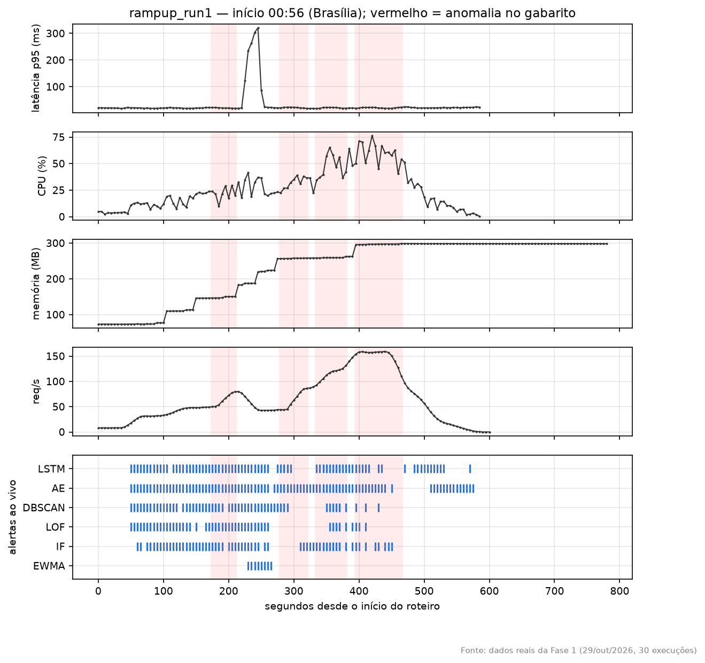
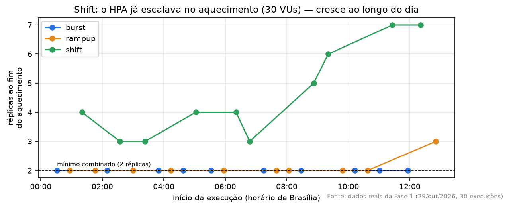
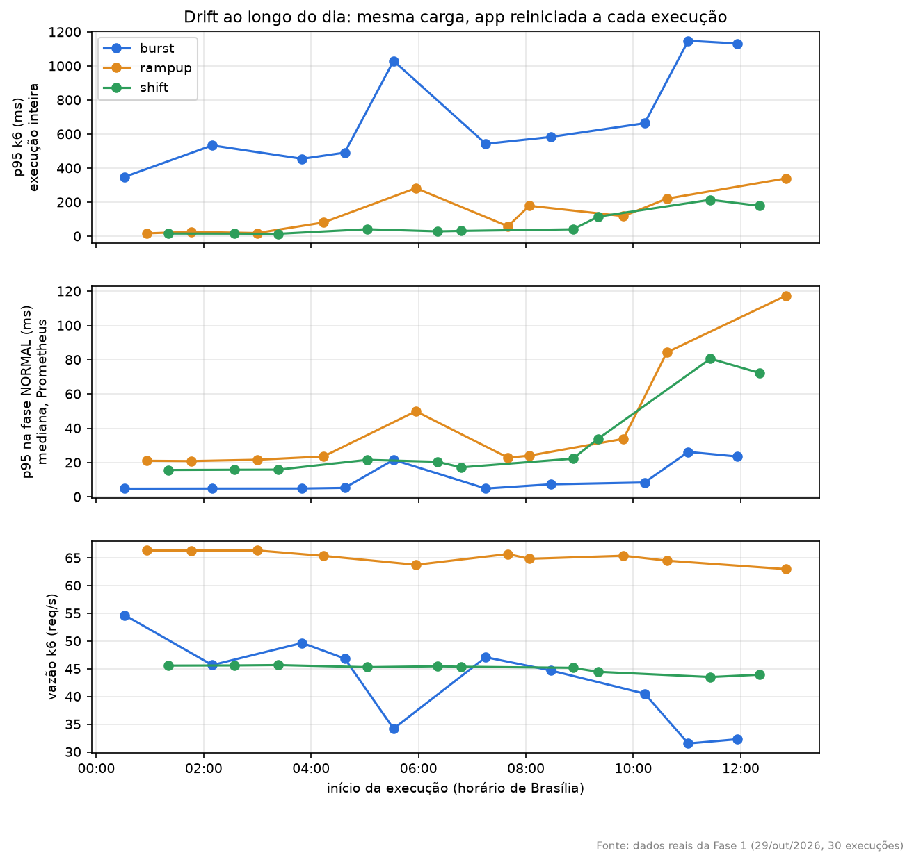

# A Fase 1 explicada

> **Explicação didática da Fase 1 definitiva** (29/out/2026): o que aconteceu, o que os números querem dizer e o que falta antes da Fase 3. Serve para a reunião com o orientador e para a banca. Em caso de divergência, valem [DECISOES_METODO.md](DECISOES_METODO.md) (decisões) e o relatório gerado `results/stats/phase1/relatorio.md` (números). Todos os números daqui saem desse relatório, do `results/detection_results.csv` e dos 30 CSVs reais da Fase 1.

## 0. Em uma frase

Os 6 detectores vigiaram ao vivo as mesmas 30 execuções. O **LSTM online** foi o melhor no conjunto e o mais rápido, e a regra escrita antes dos dados o escolheu para o modo B. No caminho apareceram quatro coisas de **ambiente e medição** que não estragam a Fase 1, mas precisam de cuidado na Fase 3.

---

## 1. O que a Fase 1 quer saber

Pense em 6 **vigias** (EWMA, IF, LOF, DBSCAN, AE e LSTM) olhando a mesma loja. A pergunta é: **quem percebe melhor, e mais rápido, quando algo estranho acontece?**

O "estranho" são 3 tipos de carga, que se repetem 10 vezes cada (30 execuções):

| Cenário | O que acontece | Analogia |
|---|---|---|
| **burst** | 3 picos curtos e fortes de usuários | um ônibus de turistas chega de repente |
| **rampup** | degraus de carga cada vez maiores | a fila cresce aos poucos, em saltos |
| **shift** | muda o **tipo** de pedido, quase sem mudar a quantidade | os clientes param de olhar e começam a pedir coisas difíceis |

Cada execução tem um **gabarito** (`ANOMALY_PHASES`): os segundos em que existe anomalia (as faixas vermelhas dos gráficos). O gabarito vem da qualificação e **nunca muda**.

---

## 2. Como cada execução rodou (a receita)

1. **Reinicia a aplicação.** Sobem 2 pods novos e cada um cria **100 itens**. Os itens são os "produtos" que a app guarda na memória: busca e relatório percorrem todos eles, então mais itens deixam a app mais lenta. Nos pilotos, os itens se acumulavam de uma execução para outra (de 100 para 4.000) e cada execução ficava mais lenta que a anterior. Reiniciar garante que toda execução comece igual.
2. **Espera o HPA voltar a 2 réplicas** e descansa 2 min (cooldown).
3. **Aquece por 330 s** com a carga normal do cenário (10, 10 e 30 usuários). O número vem da memória do detector, (60 pontos + 6 de folga) × 5 s = 330 s: quando o roteiro começa, a memória está cheia de "normal". Nos pilotos, sem aquecimento, o detector aprendia o **silêncio** entre execuções e dava 53–87% de alarmes falsos.
4. **Roda o roteiro do k6**, com a carga normal e as anomalias.
5. **Salva um CSV**, com um ponto a cada 5 s: latência, CPU, memória, requisições por segundo, o gabarito e o alerta de cada um dos 6 vigias.

Os 6 rodaram **juntos num pod só**, lendo as mesmas métricas no mesmo instante, e cada um decide sozinho. Na Fase 3 roda só o escolhido (LSTM). Como os algoritmos não se influenciam, a resposta dele é a mesma; o pod só fica mais leve.

**Como foi a noite:** de 00h24 às 13h (Brasília), 30 execuções, todas com o resumo do k6. O detector não reiniciou nenhuma vez e fechou cada ciclo com folga: p95 de 0,86 s, contra um limite de 2,5 s.

---

## 3. O resultado

### Como se mede "detectar bem"

- **Precisão:** dos alarmes que o vigia deu, quantos eram anomalia de verdade. Mede se ele grita à toa.
- **Recall:** das anomalias que aconteceram, quantas ele alarmou. Mede se ele deixa passar.
- **F1:** junta as duas numa nota de 0 a 1. Só é alto se as duas forem altas. É a nota principal.
- **MTTD:** quantos segundos do início da anomalia até o 1º alarme. Mede a rapidez.

### O placar ao vivo (online), média das 10 execuções

| Posição | Detector | burst | rampup | shift | **Média** | MTTD | Janelas detectadas |
|---|---|---|---|---|---|---|---|
| 1 | **LSTM** | 0,46 | **0,51** | **0,46** | **0,476** | **11,6 s** | 99/100 |
| 2 | IF | **0,53** | 0,47 | 0,39 | 0,464 | 20,9 s | 96/100 |
| 3 | AE | 0,42 | 0,47 | 0,42 | 0,435 | 17,5 s | 99/100 |
| 4 | DBSCAN | 0,42 | 0,44 | 0,35 | 0,401 | 21,4 s | 90/100 |
| 5 | LOF | 0,30 | 0,43 | 0,35 | 0,358 | 20,6 s | 76/100 |
| 6 | EWMA | 0,27 | 0,15 | 0,06 | 0,162 | 31,0 s | 26/100 |

### A regra do B, escrita em 16/out (antes dos dados)

1. Maior média nos 3 cenários: **LSTM** (0,476).
2. Empate é quem **não** tem diferença significativa para o 1º **em nenhum** cenário. Ninguém ficou nesse grupo: o IF difere no burst (melhor) e no shift (pior), e o AE difere no burst.
3. Ciclo p95 < 2,5 s: ok.

**Escolhido: LSTM.** Mesmo que o IF entrasse no empate, o critério seguinte (menor MTTD) também daria o LSTM: 11,6 s contra 20,9 s. A escolha é robusta.

**O que vai para o texto, sem esconder:** no burst o IF foi melhor que o LSTM, e com diferença significativa. O LSTM ganha no conjunto porque não cai no shift.

---

## 4. Offline × online: por que comparar, e por que o placar inverte

### Os dois jeitos de avaliar

- **Offline:** o detector recebe o CSV **inteiro** depois que tudo acabou, como quem lê o diário do dia seguinte. Foi como a **qualificação** avaliou.
- **Online:** o detector decide **na hora**, a cada 5 s, só com o passado. É como ele trabalha de verdade, e é o que alimenta o HPA na Fase 3.

### Por que comparar

1. **É o achado, e é o motivo mais forte.** Neste protocolo, o ranking offline **não previu** o online: no offline o melhor foi o EWMA (0,30) e o LSTM ficou no meio (3º de 6, com 0,18); ao vivo, o EWMA foi o último e o LSTM o primeiro. Quem escolhesse o detector só pela avaliação offline teria escolhido outro.
2. **Continuidade com a qualificação.** Ela foi toda offline. Sem o offline, a banca não vê o que mudou ao passar para o uso real.
3. (Uso possível, não testado) a análise depois de um incidente, com o dia inteiro na mão.

**Os números (teste pareado, 18 comparações: 6 detectores × 3 cenários):**
- em **14**, o online foi significativamente **melhor**;
- em **2** (o EWMA, no burst e no rampup), o **offline** foi melhor;
- em **2** (o LOF no burst e o EWMA no shift), não houve diferença significativa.

### Por que o placar inverte (não é mágica, são regras diferentes)

| | Offline | Online |
|---|---|---|
| Aprende o "normal" com | a execução inteira, **anomalias incluídas** | os últimos 5 min, que começam **limpos** (aquecimento) |
| Quantos pontos pode marcar (IF, LOF) | **no máximo ~10%** (`contamination=0.1`) | todos os que passarem da média + 2σ do normal |
| EWMA | referência **fixa** nos primeiros 150 s | referência **móvel**, que anda junto |

O efeito aparece na média de precisão e recall:

| | Precisão | Recall |
|---|---|---|
| IF, LOF, DBSCAN, AE, LSTM **offline** | 0,31–0,61 | **0,09–0,19** |
| os mesmos **online** | 0,35–0,45 | **0,38–0,62** |

- **Offline:** as anomalias ocupam 19% (burst), 29% (rampup) e 51% (shift) dos pontos, mas o detector "tem cota" para marcar só ~10%. Quando alarma, costuma acertar (precisão razoável), mas deixa passar quase tudo (recall baixo).
- **Online:** marca tudo que destoa. Pega bem mais anomalias (recall alto) e erra um pouco mais (ver a seção 5).
- **O EWMA faz o caminho inverso.** No offline, a referência fica parada no início limpo e qualquer subida destoa. No online, ele **se acostuma** com o patamar novo de uma anomalia longa e para de alarmar. Isso é uma limitação conhecida, escrita no próprio código. Além disso, ele só olha a latência, enquanto os outros olham 4 sinais.

**A frase segura:** *"neste protocolo, o ranking offline não previu o online"*. Não é que um algoritmo seja bom ou ruim em geral; as regras de avaliação são diferentes.

---

## 5. Alertas antes da 1ª anomalia: o que é aquilo no gráfico?

No rampup e no shift, quase todos os vigias alarmam **bem antes** da 1ª faixa vermelha. **Não é o aquecimento.** É o **próprio roteiro**, que aumenta a carga ainda na parte que o gabarito chama de "normal":

| Cenário | Aquecimento | O roteiro, antes da 1ª anomalia | Gabarito |
|---|---|---|---|
| burst | 10 usuários | fica em **10** até 150 s | 1ª anomalia aos 150 s |
| rampup | 10 usuários | sobe para **40** aos 30–40 s e para **65** até 175 s ("degraus 1 e 2") | 1ª anomalia aos 175 s ("anômalo a partir do 3º degrau") |
| shift | 30 usuários | sobe para **50** entre 30 e 150 s | 1ª anomalia aos 150 s |

O vigia aprendeu "normal = 10 usuários". Quando a carga quadruplica, ele **corretamente** vê que algo mudou. Mas o gabarito da qualificação diz que aquilo ainda é normal, então esses alarmes contam como **falsos positivos**.

**Medido nas 30 execuções:** % dos pontos normais (de 60 s até a 1ª anomalia) com alerta.

| | EWMA | IF | LOF | DBSCAN | AE | LSTM |
|---|---|---|---|---|---|---|
| burst | 7% | 5% | 6% | 7% | 9% | 19% |
| rampup | 24% | 94% | 67% | 97% | 98% | 99% |
| shift | 0% | 57% | 92% | 91% | 93% | 93% |

No **burst**, onde o roteiro fica no nível do aquecimento, quase não há alarmes. Foi esse o cenário dos pilotos 3 e 4, que validaram "alertas iniciais perto de 0%". **Rampup e shift nunca tinham sido medidos assim antes da Fase 1.** Fenômeno parecido aparece no fim do shift: a carga desce até zero, e 78–100% dos pontos do encerramento têm alerta nos multivariados.

**O que isso muda:**
- **Na Fase 1:** baixa a **precisão** de todos os detectores online em rampup e shift. Vale igual para todos, porque viram as mesmas execuções, então não muda quem ganha. O EWMA sofre menos, porque só olha a latência, que quase não sobe nesses degraus.
- **Na Fase 3:** no rampup e no shift, o modo B pode **escalar antes da 1ª anomalia**. Isso aparece como `false_scaleups` e custo maior, e pode fazer picos ficarem "sem reação", porque o HPA já escalou (decisão 15). É um comportamento real do B, que deve ser descrito, não corrigido.
- **O que não se faz:** mudar o gabarito, os roteiros ou o aquecimento. Os três são da qualificação ou decididos antes, e mudá-los agora seria ajustar o método depois de ver os resultados. O fenômeno entra como achado e limitação.

---

## 6. As surpresas do ambiente e da medição

### O shift não "cabe" em 2 pods

O aquecimento do shift (30 usuários) já passa de 50% de CPU em 2 pods. O HPA escalava ainda no aquecimento: **3 a 7 pods** no início, nas **10 de 10** execuções. Burst e rampup começaram com 2 pods; a única exceção foi o rampup da execução 10, com 3.

### A VPS ficou mais lenta ao longo do dia (drift)

Com a mesma carga e a app reiniciada toda vez, a latência da fase normal ficou estável de madrugada e subiu de 2 a 5 vezes depois das ~09h30:

| p95 na fase normal | madrugada | fim da manhã |
|---|---|---|
| burst | ~5 ms | 23–26 ms |
| rampup | ~21 ms | 84–117 ms |
| shift | ~16 ms | 72–80 ms |

Houve também um soluço isolado às 05h30, que voltou ao normal às 07h. Suspeita principal, **ainda não verificada**: os outros serviços da VPS trabalham mais de dia e disputam CPU com o laboratório.

### Os "pontos-fantasma" no fim do CSV

Cada CSV cobre uma janela fixa, herdada da qualificação: burst 720 s, rampup **780 s**, shift 960 s. Os roteiros k6 acabam antes: 618, **560** e 910 s. E o script exportava ~15 s depois do fim do k6. Ou seja, no rampup ele pedia ao Prometheus **3 minutos que ainda não tinham acontecido**.

O Prometheus não recusa. Para o "futuro", ele devolve:
- **vazio**, em latência, CPU e req/s;
- o **último valor repetido**, por até 5 min, em memória, alertas e réplicas.

É como uma foto da última cena colada várias vezes no fim do filme.

| Cenário | Pontos-fantasma | Alertas repetidos com valor 1 (10 execuções) |
|---|---|---|
| burst | ~12 por execução (9%) | nenhum |
| rampup | ~36 por execução (**23%**) | IF 109, AE 144, LOF 36, LSTM 36 |
| shift | 2 por execução (1%) | 12–20 por detector |

A qualificação tem o **mesmo rabo**, e por isso a Fase 1 fica como foi: igual à qualificação, sem mexer em nenhum número oficial.

**Isso muda a escolha do B? Não.** Refiz a conta (primeiro reproduzindo exatamente os F1 oficiais) e tirei os pontos-fantasma:

| | F1 online médio, oficial | sem os fantasmas |
|---|---|---|
| LSTM | 0,476 | 0,481 |
| IF | 0,464 | 0,476 |

O LSTM continua em 1º. O IF continua fora do empate pela diferença significativa no burst (que não tem fantasmas), e o desempate por MTTD não depende do rabo. Mas a folga fica pequena (0,005): mais um motivo para dizer, com todas as letras, que o IF foi melhor no burst.

**Na Fase 3:** o script agora **espera o fim da janela** antes de exportar, para o custo (`pod_seconds`) só ter réplicas medidas (decisão 16). Custa ~2,7 h a mais.

---

## 7. Por que a Fase 1 continua válida

Pense numa **corrida com vento**:

- **Fase 1: todos correm juntos, na mesma bateria.** Os 6 vigias viram **a mesma execução, ao mesmo tempo**. Se o vento (drift) atrapalhou uma execução, atrapalhou os 6. A comparação é feita **dentro de cada execução** (teste pareado), então o vento se cancela.
- **Fase 3: cada modo corre numa bateria diferente.** A, B e C são execuções separadas, então o vento **não** se cancela sozinho. Por isso as decisões 14 e 15 (seção 9).

---

## 8. A estatística, em linguagem de gente

### A pergunta de fundo

Se eu rodar de novo, o resultado se repete? Cada execução dá um número um pouco diferente, como subir 10 vezes na balança. A estatística diz **o quanto dá para confiar na média**.

### Passo 1: a média e o "mais ou menos" (intervalo de confiança)

O LSTM online teve F1 0,46 no burst, mas execução a execução deu 0,37, 0,43, 0,54… O **intervalo de confiança de 95%** diz: "a média verdadeira está entre X e Y, com 95% de confiança".

> **média ± t × (desvio padrão ÷ √N)**

- **N = 10** execuções.
- **t = 2,262** é o valor da tabela t de Student para 10 execuções (9 graus de liberdade). Ele alarga o intervalo porque 10 é pouco.
- **desvio padrão ÷ √N** é o quanto a média "balança". Com mais execuções, ela balança menos e o intervalo estreita.

Exemplo real, burst: LSTM 0,462 ± 0,031, ou seja, **0,431 a 0,492**.

### Passo 2: comparar dois detectores (o teste pareado)

Exemplo real, burst, LSTM × IF:

| | F1 médio | Intervalo 95% |
|---|---|---|
| LSTM | 0,462 | 0,431 a 0,492 |
| IF | 0,528 | 0,495 a 0,560 |

Olhando só os intervalos, eles **quase se encostam**, e daria para pensar "talvez empate". Mas veja **execução por execução**:

| execução | 1 | 2 | 3 | 4 | 5 | 6 | 7 | 8 | 9 | 10 |
|---|---|---|---|---|---|---|---|---|---|---|
| LSTM | 0,47 | 0,46 | 0,43 | 0,48 | 0,54 | 0,47 | 0,49 | 0,46 | 0,46 | 0,37 |
| IF | 0,50 | 0,53 | 0,53 | 0,53 | 0,58 | 0,55 | 0,60 | 0,47 | 0,54 | 0,45 |
| **diferença** | −0,03 | −0,07 | −0,10 | −0,04 | −0,05 | −0,08 | −0,11 | −0,02 | −0,08 | −0,08 |

O IF ganhou nas **10**. O teste pareado faz a conta sobre essas diferenças:

> **d̄ ± t × (S_d ÷ √N)** = −0,066 ± 2,262 × (0,031 ÷ √10) = **−0,088 a −0,044**

**O zero não está dentro**, então a diferença é real (p = 0,0001).

**Por que o pareado enxerga melhor:** na execução 10 (meio-dia, VPS lenta) os **dois** caíram, o LSTM para 0,37 e o IF para 0,45. A queda era do ambiente. Quando se subtrai, ela some e sobra só a diferença entre os detectores. É o "vento se cancelando" da seção 7, em números.

### Passo 3: o p-valor, sem mistério

O p-valor responde: **"se os dois fossem iguais, qual a chance de ver uma diferença deste tamanho só por sorte?"** p = 0,0001 quer dizer 1 em 10 mil, improvável demais, então não são iguais. A regra usada é p < 0,05, que equivale a "o zero fora do intervalo de 95%".

### Passo 4: por que só algumas comparações

Com 12 resultados (6 offline + 6 online), dá para fazer 66 pares. Se você faz muitos testes, algum dá "significativo" **por sorte**. Por isso decidimos **antes** quais comparar: as 6 offline × online e as 5 do escolhido contra os outros, por cenário. Cada uma responde a uma pergunta da pesquisa. Como elas foram planejadas, a ANOVA prévia foi dispensada (decisão 13).

### Passo 5: a Fase 3 é diferente

A, B e C são execuções **separadas**, então não há o que subtrair. Usa-se o **t de Student não pareado**:

- compara as duas médias levando em conta a variação de cada uma;
- 10 + 10 − 2 = 18 graus de liberdade (t ≈ 2,101);
- dá um p-valor.

Ao lado, vai o **teste visual**: se os intervalos dos dois modos não se sobrepõem, a diferença é clara. Como o "vento" não se cancela sozinho, a decisão 14 existe para **mostrar** que ele soprou igual em A, B e C.

### Passo 6: os diagnósticos

- **Shapiro-Wilk:** confere se os 10 valores têm cara de distribuição normal, o que o intervalo pressupõe. p baixo indica cuidado; ele aparece, por exemplo, no EWMA do shift, que tem muitos zeros.
- **Replicações necessárias:** quantas execuções seriam precisas para o "mais ou menos" ficar em 10% ou 20% da média. Isso mostra se 10 bastou.

---

## 9. O que foi decidido para a Fase 3 (29/out/2026, só com dados de ambiente)

- **14, drift.** Mantém o desenho: cada repetição roda os 9 pares (modo × cenário) em ordem sorteada, num bloco de ~3,5 h, então o drift cai igual nos três modos. Em cada execução, registra a lentidão do **aquecimento** (`warmup_p95_ms`, sempre no modo A, antes do tratamento). **Antes** de olhar o tempo de reação, mostra que essa lentidão ficou equilibrada entre A, B e C. Não exclui nem refaz execuções lentas.
- **15, shift.** Mantém o shift. O tempo de reação conta só os picos em que o HPA precisou escalar, e ao lado vão os picos sem reação e as réplicas no início.

- **16, pontos-fantasma.** Na Fase 3, o script espera o fim da janela medida antes de exportar. A Fase 1 fica igual à qualificação.

Detalhes e motivos: [DECISOES_METODO.md](DECISOES_METODO.md), itens 14, 15 e 16. Falta confirmar com o orientador.

---

## 10. O que falta antes da Fase 3

1. **Backup** de `results/` e `datasets/` fora da VPS (feito no notebook em 29/out).
2. **Fixar o B:** `HPA_B_DETECTOR=LSTM` e `DETECTOR_ALGOS=LSTM` no `.env` da VPS; `git pull`; `make build-analysis`; `make selftest`; `make detector-deploy`.
3. **Diagnosticar o drift, só olhando,** antes de o Prometheus apagar a Fase 1 (~05/nov):
   - de dia, na VPS: `uptime`, `top`, `docker stats`;
   - no Grafana: throttling da app nas horas da Fase 1.
4. `make hpa-mode HPA_MODE=B && make phase2-check`, depois `make hpa-experiment` (~35 h).

---

## 11. Frases prontas para a reunião e a banca

1. "Os 6 detectores viram as mesmas 30 execuções ao vivo. O LSTM teve o melhor F1 médio (0,48) e o menor tempo de detecção (11,6 s), e a regra escrita antes dos dados o escolheu."
2. "Neste protocolo, o ranking offline não previu o online: em 14 de 18 comparações o online foi significativamente melhor, e o melhor offline (EWMA) foi o pior online."
3. "O IF foi melhor no burst, com diferença significativa; o LSTM venceu no conjunto porque não cai no shift."
4. "A VPS ficou mais lenta de dia. Na Fase 1 isso não afeta a comparação, porque o teste é pareado. Na Fase 3, os modos rodam misturados em blocos sorteados e a lentidão é medida para mostrar o equilíbrio."
5. "No rampup e no shift, os detectores alarmam quando a carga sobe na parte que o gabarito chama de normal. É um limite do gabarito herdado da qualificação, igual para todos, e foi registrado, não corrigido."
