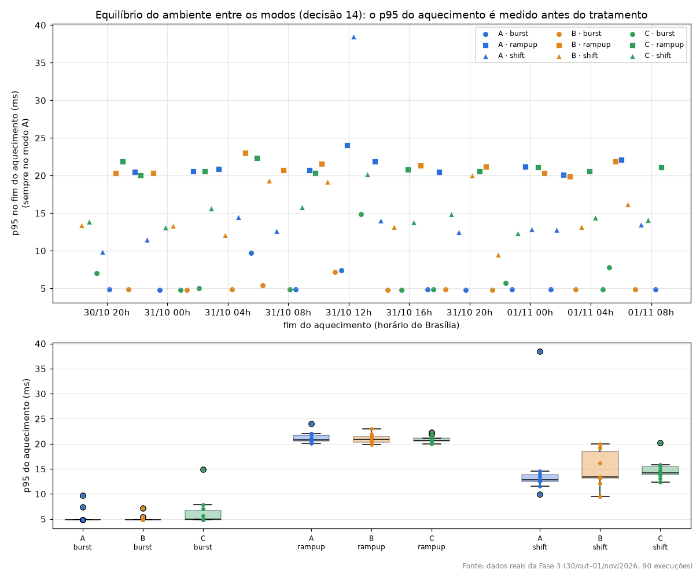
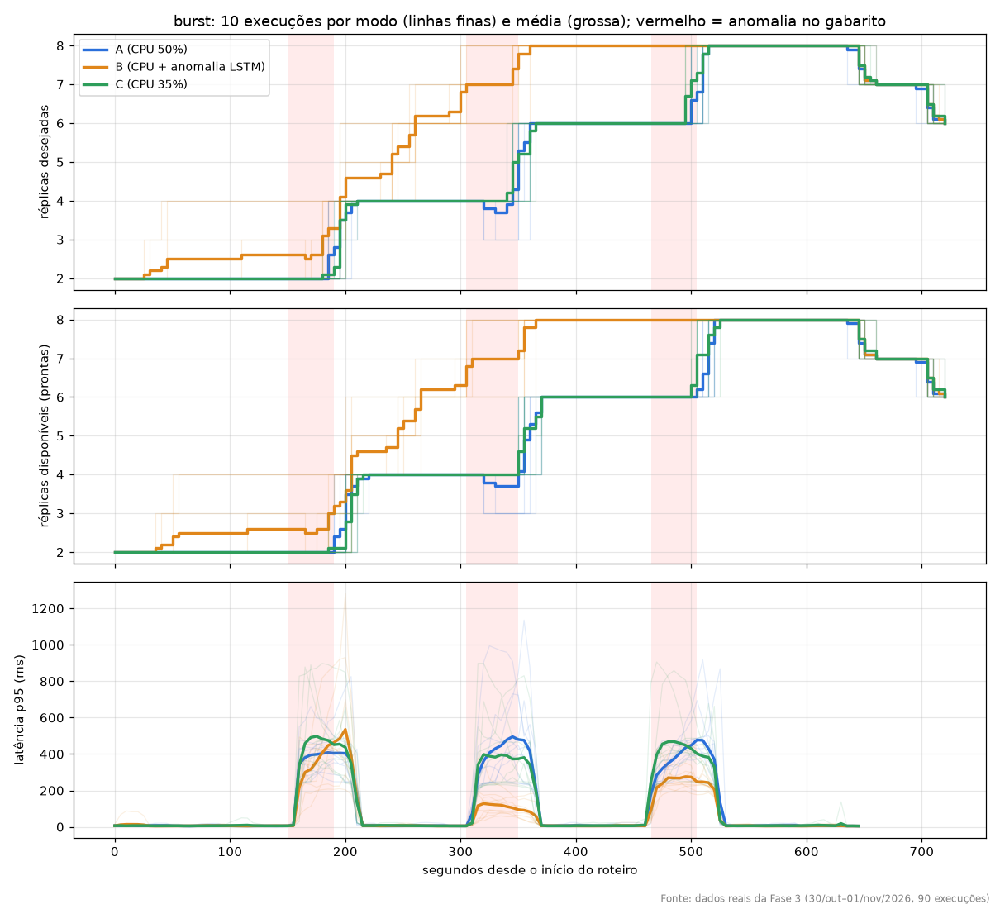
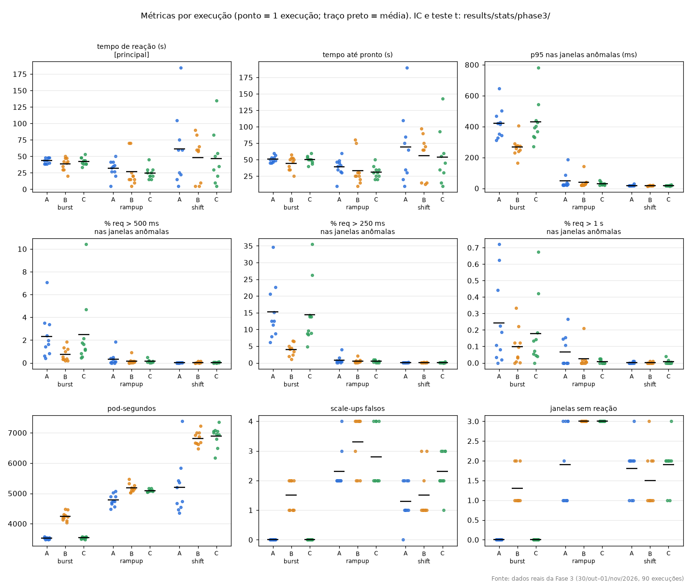

# A Fase 3 explicada

> **Explicação didática da Fase 3 definitiva** (30/out a 01/nov/2026): o que aconteceu, o que os números querem dizer e se o resultado invalida a pesquisa. Serve para a reunião com o orientador e para a banca. Em caso de divergência, valem [DECISOES_METODO.md](DECISOES_METODO.md) (decisões) e o relatório gerado `results/stats/phase3/relatorio.md` (números). Todos os números daqui saem desse relatório, do `results/hpa/hpa_results.csv`, do `results/warmup_log.csv` e das séries de réplicas (`results/hpa/series/`). Backup: `VPS/FASE 3/backup_fase3_2026-11-01` no notebook.

## 0. Em uma frase

O **tempo de reação** (a métrica principal, escolhida antes) **não mostrou diferença** entre A, B e C em nenhum cenário. Mas no **burst** o B deixou a aplicação bem **mais rápida para o usuário** (p95 de 422 → 266 ms; requisições acima de 250 ms de 15% → 4%), porque **escalou antes** do pico, puxado pelo alerta do LSTM, pagando **~20% a mais de pods** e ~1,5 scale-up falso por execução. Pelo critério escrito antes, o B **não** venceu; o resultado é negativo na métrica principal e positivo em latência no burst, e as duas coisas entram na dissertação.

---

## 1. O que a Fase 3 quer saber

O HPA comum (modo **A**) só pede pods quando a CPU já subiu: chega tarde. O modo **B** soma ao HPA o alarme do detector escolhido na Fase 1 (o **LSTM** online). O modo **C** não tem detector: só escala mais cedo (CPU 35%), para separar "o ganho de detectar" de "o ganho de simplesmente ter mais pods".

Três comparações planejadas, por cenário: **B × A** (o detector ajuda?), **B × C** (é a detecção ou só mais pods?), **C × A** (escalar cedo basta?). Teste t de Student **não pareado** (A, B e C são execuções diferentes).

## 2. Como rodou

- 90 execuções (3 modos × 3 cenários × 10 repetições), de **30/out 18h19 a 01/nov ~08h50** (horário de Brasília), na VPS, em blocos por repetição com ordem sorteada (decisão 14).
- Detector: só o LSTM, rodando **igual nos três modos**; o modo só muda quem ouve o alarme.
- Uma falha logo no início: a pasta `datasets_hpa/` tinha ficado com dono root e a 1ª tentativa do `B_shift_run1` não conseguiu gravar o CSV. A execução não foi marcada como feita, a pasta foi corrigida e o `B_shift_run1` rodou de novo do zero. Nenhum dado foi aproveitado da tentativa que falhou (a linha dela no `warmup_log.csv` fica de fora da análise).
- Todas as 90 têm resumo do k6, série de réplicas e linha no `hpa_results.csv`.

## 3. Antes de tudo: o ambiente ficou igual para os três modos (decisão 14)

Na Fase 1, a VPS ficou mais lenta ao longo do dia (drift). Como na Fase 3 o teste não é pareado, um modo que caísse mais nas horas lentas pareceria pior só por isso. Por isso, em cada execução, medimos o p95 da latência **no aquecimento**, que roda sempre no modo A, **antes** do tratamento.

| cenário | A | B | C | ICs se sobrepõem? |
|---|---|---|---|---|
| burst | 5,6 [4,4–6,8] ms | 5,2 [4,6–5,7] ms | 6,5 [4,2–8,7] ms | sim |
| rampup | 21,3 [20,4–22,1] ms | 21,1 [20,4–21,7] ms | 20,9 [20,4–21,4] ms | sim |
| shift | 15,3 [9,4–21,2] ms | 14,9 [12,4–17,5] ms | 14,8 [13,3–16,4] ms | sim |

**Conclusão: equilibrado.** O drift forte da Fase 1 não se repetiu; o único ponto fora da curva é o `A_shift_run5` (38,5 ms), mantido (decisão 14: não excluir execução lenta).

Réplicas no fim do aquecimento (decisão 15): **2** em todas as execuções de burst e rampup; no shift, A 3,0, B 3,2, C 3,2 em média (o shift já começa escalado, igual nos três modos, como na Fase 1).

## 4. A métrica principal: tempo de reação

Tempo entre o início de cada pico (janela anômala) e o 1º pedido de mais pods; média só nas janelas com reação (decisão 15).

| | A | B | C | B × A | B × C | C × A |
|---|---|---|---|---|---|---|
| burst | 43,5 s | 38,5 s | 42,5 s | p = 0,15 | p = 0,28 | p = 0,68 |
| rampup | 31,6 s | 26,5 s | 24,5 s | p = 0,56 | p = 0,80 | p = 0,17 |
| shift | 61,4 s | 48,3 s | 46,9 s | p = 0,56 | p = 0,94 | p = 0,54 |

**Nenhuma das 9 comparações é significativa.** O B tem a média menor que a do A nos três cenários, mas a diferença é pequena perto da variação. O tempo até os pods ficarem prontos (`ready_time_s`) segue o mesmo padrão (nenhuma diferença significativa).

## 5. Por que não deu diferença: o B se antecipa, e o teto de 8 pods

> **Análise exploratória**, feita depois de ver os dados, a partir das séries de réplicas salvas. É descrição, não teste; nenhuma métrica nem decisão fechada mudou.

Quantas réplicas cada modo **já tinha** no início de cada pico, e em quantas das 10 execuções houve reação:

| janela | A | B | C |
|---|---|---|---|
| burst, 1º pico | 2,0 réplicas; reagiu 10/10 | **2,6**; 10/10 | 2,0; 10/10 |
| burst, 2º pico | 4,0; 10/10 | **7,0**; 7/10 (3 já no teto) | 4,0; 10/10 |
| burst, 3º pico | 6,0; 10/10 | **8,0; 0/10 (todas no teto)** | 6,0; 10/10 |
| rampup, 1º degrau | 4,7; 10/10 | 6,1; 10/10 | 6,0; 10/10 |
| rampup, 2º ao 4º degrau | 7,2–8,0; reage em parte | **8,0 (teto) em todas** | **8,0 (teto) em todas** |
| shift, 1º ao 3º | 4,8–6,0 | 6,2–8,0 | 6,1–7,9 |

O que isso mostra:

1. **O B escala antes do pico.** Depois de cada pico, o LSTM continua alertando por um tempo (a "cauda" já vista nos pilotos 4 e 5), e o B segue pedindo pods com a carga normal. Ele entra no pico seguinte já escalado.
2. **O tempo de reação não enxerga isso.** Ele só conta pedidos feitos **depois** do início do pico. Um pod pedido antes não conta como "reação rápida"; conta como nada.
3. **O teto de 8 pods (`maxReplicas`) corta a comparação.** Quando o B (e, no rampup, também o C) já está no máximo, não há pedido a fazer, e aquele pico sai da média. Assim, a média de cada modo vem de **picos diferentes**: no rampup, B e C só têm o 1º degrau; o A tem mais.
4. **O único pico comparável de igual para igual** é o 1º do burst (os três reagem nas 10 execuções, partindo de 2 pods): A 43 s, B 38 s, C 44 s. Diferença pequena.

No gráfico, as linhas grossas são a média das 10 execuções de cada modo. A laranja (B) sobe entre os picos; azul (A) e verde (C) só sobem dentro deles. Embaixo, a latência do B no 2º e no 3º pico fica em menos da metade da dos outros.

## 6. As métricas secundárias

**Burst** (onde aparecem as diferenças):

| | A | B | C | B × A |
|---|---|---|---|---|
| p95 nas janelas anômalas | 422 ms | **266 ms** | 430 ms | p = 0,0005 |
| % requisições > 500 ms (SLO) | 2,3% | **0,7%** | 2,5% | p = 0,025 |
| % requisições > 250 ms | 15,2% | **4,0%** | 14,4% | p = 0,0008 |
| % requisições > 1 s | 0,24% | 0,10% | 0,18% | n.s. |
| p95 do k6 (execução inteira) | 462 ms | **289 ms** | 469 ms | p = 0,0003 |
| pod-segundos (custo) | 3.517 | **4.239 (+20%)** | 3.534 | p < 0,0001 |
| scale-ups falsos | 0 | **1,5** | 0 | p < 0,0001 |

B × C dá o mesmo quadro (latência e SLO a 250 ms melhores no B, p ≤ 0,004; SLO a 500 ms com p = 0,09; custo +20%). C × A: nenhuma diferença em latência nem custo.

**Rampup e shift:** latência e SLO **sem diferença** entre os modos. Custo: B acima do A (rampup +8%, shift +31%) e parecido com o C (C também acima do A). Scale-ups falsos aparecem nos três modos (no rampup e no shift, a CPU também gera pedidos fora dos picos).

## 7. O veredito pelo critério escrito antes

Critério ([HPA.md](HPA.md)): **"B é melhor se reduz o tempo de reação e a violação de SLO em relação a A, com pod·s semelhante ao de C."**

| Parte do critério | Resultado |
|---|---|
| reduz o tempo de reação | **não** (nenhum cenário) |
| reduz a violação de SLO | **só no burst** |
| custo semelhante ao do C | **não no burst** (+20%); sim no rampup e no shift |

**O critério não foi atendido.** O que a Fase 3 mostra:

- **Negativo:** acoplar o LSTM ao HPA **não** fez o HPA reagir mais rápido depois do início do pico.
- **Positivo, com custo:** no burst, o B **antecipou** a escala (por causa da cauda de alertas) e reduziu muito a latência sentida pelo usuário, gastando ~20% mais pods e gerando scale-ups falsos. Escalar cedo sem detector (C) **não** obteve esse ganho.
- **Neutro:** em cargas graduais (rampup) e de mudança de tipo (shift), o detector não mudou a latência.

### Houve um modo melhor? A, B ou C

**Pela regra escrita antes, não houve vencedor.** Olhando cada critério separado:

| Critério | Quem foi melhor | Onde |
|---|---|---|
| latência e SLO | **B** (p < 0,03 contra A e contra C) | só no **burst**; no rampup e no shift, empate |
| custo (pod·s) | **A** | burst: A = C, B +20%; rampup e shift: A gasta menos que B e C |
| tempo de reação | empate | todos os cenários |
| o C | **nenhum critério** | gastou o mesmo ou mais que o A e nunca melhorou a latência |

Em resumo:
- **A** é o mais econômico;
- **B** compra latência no burst pagando em pods;
- **C** mostra que só escalar mais cedo pela CPU custa mais sem ganho. Ou seja, o ganho do B no burst não vem de "ser mais sensível à CPU".

Entre A e B, a escolha depende de quanto vale latência contra pods: é um **compromisso**, e os dados não escolhem sozinhos. Uma ressalva: o C não gastou o mesmo que o B no burst, então ele não isola por completo "detecção × pods a mais"; isso só um controle com o mesmo custo do B responderia (experimento complementar, opcional).

## 8. Isso invalida a pesquisa? Precisa rodar tudo de novo?

**Não invalida, e não deve ser rodado de novo.**

- **Um resultado nulo é um resultado.** A pergunta era "o HPA com detector reage antes?". A resposta medida, com método fixado antes e 90 execuções, é "não, pelo tempo de reação; mas antecipa a escala no burst e reduz a latência, a um custo". Isso responde à pergunta da pesquisa.
- **O que dá credibilidade ao trabalho é justamente não ter mudado nada depois de ver os dados.** Refazer as fases mudando a métrica, o teto ou o detector agora seria escolher o método pelo resultado (é a regra "nunca mudar uma decisão fechada depois de ver resultados"). A banca valoriza um nulo honesto mais do que um positivo "ajustado".
- **Fases 1 e 2 não são afetadas.** A Fase 1 (qual detector é melhor ao vivo) e a Fase 2 (integração do detector ao HPA, que funcionou nas 30 execuções do B) estão completas e válidas.
- **O que é legítimo fazer** (sem refazer nada): relatar a análise da seção 5 como **exploratória**, discutir o teto de 8 pods e a definição do tempo de reação como **limitações**, e propor como **trabalhos futuros** um experimento com teto maior e uma métrica de antecipação (por exemplo, réplicas disponíveis no início do pico), definidos antes de rodar. Se o orientador quiser um experimento extra, ele entra **como novo, separado e rotulado**, nunca substituindo a Fase 3.

## 9. Limitações a declarar

- **Variação alta do tempo de reação.** Replicações necessárias para H/Ȳ ≤ 20%: burst 2–8; rampup 18–102; shift 63–113. Com N = 10, rampup e shift não têm poder para detectar diferenças pequenas.
- **Teto de 8 réplicas** (fixado antes, não alterado): tira picos da média e impede a comparação nos últimos picos do burst (B) e nos degraus 2–4 do rampup (B e C). Por que 2 e 8: ver a seção 9a.
- **Tempo de reação definido como pedido depois do início do pico:** não capta antecipação.
- **Normalidade:** Shapiro-Wilk com p < 0,05 em várias células (ex.: tempo de reação no rampup B, p = 0,002). O t de Student é robusto com N = 10 por grupo, mas isso fica declarado.
- **Muitas comparações sem correção** (9 por métrica): as planejadas são as do tempo de reação; as das secundárias são lidas como apoio, não como prova isolada.
- **Shift começando escalado** (decisão 15) e as demais ameaças já declaradas (decisão 9).

## 9a. Por que piso de 2 e teto de 8 pods

Os limites vêm da **qualificação** (abr/2026) e foram mantidos sem mudança, para comparabilidade ([DECISOES_METODO.md](DECISOES_METODO.md), item 9). Não foram calculados para a Fase 3; a justificativa técnica é:

- **Piso 2:** com 1 pod, qualquer reinício derruba a app (ponto único de falha); com 2, o Service já balanceia desde o início; e toda execução parte da mesma condição (2 réplicas).
- **Teto 8:** 8 pods × 300m de limite = **2,4 núcleos**, dentro dos **6 núcleos** do cluster, com folga para o detector (0,5), o Prometheus, o Grafana e o k3s. Um teto maior faria os pods disputarem CPU, e a latência pioraria por falta de máquina, misturando esse efeito com o do HPA. Além disso, todo HPA em produção tem um `maxReplicas`, que é o limite de custo.

Texto para a dissertação:

> Os limites do HPA foram mantidos em 2 e 8 réplicas, os mesmos da etapa de qualificação, para preservar a comparabilidade. O piso de 2 réplicas evita ponto único de falha e garante a mesma condição inicial em todas as execuções. O teto de 8 réplicas mantém a demanda máxima da aplicação (8 × 300m = 2,4 núcleos) dentro da capacidade reservada ao cluster (6 núcleos), sem disputa de CPU com o detector e o monitoramento, e representa o limite de custo presente em todo HPA de produção. Na Fase 3, esse teto foi atingido pelos modos B e C no rampup e pelo modo B no burst, retirando esses picos do cálculo do tempo de reação; o efeito é declarado como limitação.

## 10. Frases prontas para a reunião e a banca

1. "Na métrica principal, o resultado foi nulo: o detector não fez o HPA reagir mais rápido."
2. "Mas no burst o detector fez o HPA escalar antes do pico e reduziu a latência do usuário quase à metade, ao custo de 20% mais pods."
3. "Escalar cedo sem detector (modo C) não teve esse ganho: o efeito vem do sinal do detector, não só de ter mais pods."
4. "O tempo de reação, como foi definido antes, não enxerga a antecipação, e o teto de 8 pods tira picos da comparação; isso é limitação declarada e trabalho futuro, não algo a corrigir depois de ver os dados."
5. "O ambiente ficou equilibrado entre os modos: o p95 do aquecimento, medido antes do tratamento, é igual em A, B e C."
6. "Não há um modo vencedor: A é o mais barato, B compra latência no burst com pods, e C custa mais sem ganho."
7. "Piso 2 e teto 8 vêm da qualificação: 2 evita ponto único de falha; 8 pods cabem nos 6 núcleos do cluster sem disputa de CPU."

## 11. Arquivos

- Relatório e ICs: `results/stats/phase3/relatorio.md`, `1_IC_hpa.csv`, `2_teste_t.csv`, `estatistica.xlsx`, figuras `fig_ic_*` e `fig_interacao_*`.
- Dados: `results/hpa/hpa_results.csv`, `results/warmup_log.csv`, `results/hpa/series/` (90 séries), `datasets_hpa/` (90 CSVs).
- Gráficos desta explicação: `VPS/FASE 3/graficos_fase3/` no notebook (inclui uma figura por execução, um PDF com as 90 e o script `graficos_fase3.py`); cópias em [figs/fase3/](figs/fase3/).
